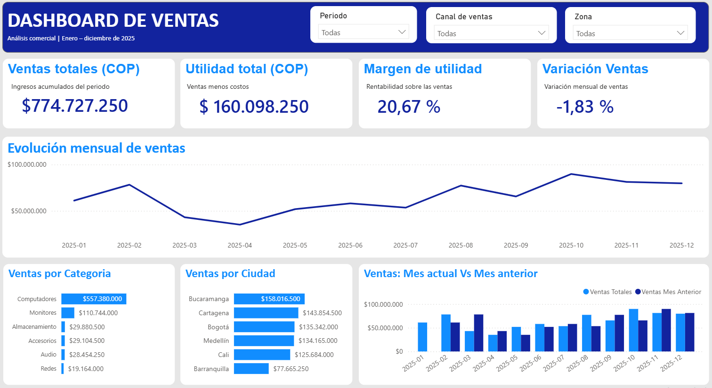

# Dashboard de ventas y análisis comercial con Power BI
Dashboard interactivo de ventas desarrollado con Power BI y DAX

## Objetivo

Desarrollar un dashboard interactivo para analizar el comportamiento de las ventas, la utilidad, el margen de utilidad y la variación mensual de un conjunto de datos comerciales.

## Herramientas utilizadas

- Power BI Desktop.
- Power Query / preparación de datos, según el proceso aplicado.
- DAX para la creación de medidas e indicadores.
- Excel para la validación de resultados.

## Desarrollo

- Construcción de un modelo de datos con tablas de ventas, productos, regiones y calendario.
- Creación y configuración de relaciones entre las tablas.
- Desarrollo de medidas DAX para calcular ventas totales, costos, utilidad, margen y variación mensual.
- Diseño de indicadores KPI y gráficos para analizar ventas por categoría, ciudad y mes.
- Implementación de segmentadores por período, canal de ventas y zona.
- Validación de los resultados mediante la comparación con Excel, aplicando filtros equivalentes.

## Indicadores incluidos

- Ventas totales.
- Utilidad total.
- Margen de utilidad.
- Variación de ventas frente al mes anterior.
- Evolución mensual de las ventas.
- Ventas por categoría y ciudad.

## Resultado

Dashboard interactivo que permite explorar los resultados comerciales mediante filtros y visualizar indicadores relevantes para el análisis de ventas.

**Nota:** proyecto de práctica.

## Vista previa del dashboard

## Modelo de datos

El proyecto utiliza un modelo de datos compuesto por cuatro tablas:

- **Ventas:** contiene las transacciones comerciales, fechas, productos, regiones, importes de venta y costos.
- **Productos:** contiene la información de los productos y sus categorías.
- **Regiones:** contiene información geográfica para analizar las ventas por ciudad y zona.
- **Calendario:** permite realizar análisis temporales y comparaciones entre períodos.

Se establecieron relaciones entre las tablas de productos, regiones y calendario con la tabla de ventas para facilitar el análisis mediante filtros.

## Medidas DAX

Se desarrollaron medidas para calcular los principales indicadores comerciales:

| Medida | Descripción |
| Ventas Totales | Suma de los importes de ventas. |
| Costos Totales | Suma de los costos registrados. |
| Utilidad Total | Suma de la utilidad de las transacciones. |
| Margen de Utilidad % | Relación entre la utilidad total y las ventas totales. |
| Ventas Mes Anterior | Calcula las ventas del mes anterior. |
| Variación Ventas | Diferencia entre las ventas del período actual y el anterior. |
| Variación Ventas % | Variación relativa de las ventas entre períodos. |

## Funcionalidades del dashboard

- Indicadores KPI para ventas, utilidad, margen y variación mensual.
- Evolución mensual de las ventas.
- Comparación de ventas frente al mes anterior.
- Análisis de ventas por categoría de producto y ciudad.
- Segmentadores interactivos por período, canal de ventas y zona.

## Validación de resultados

Los resultados del dashboard se contrastaron con los datos de Excel, aplicando filtros equivalentes en ambas herramientas. Los valores obtenidos coincidieron durante las comprobaciones realizadas.

## Datos y alcance

Este proyecto utiliza datos ficticios con fines educativos y demostrativos.

